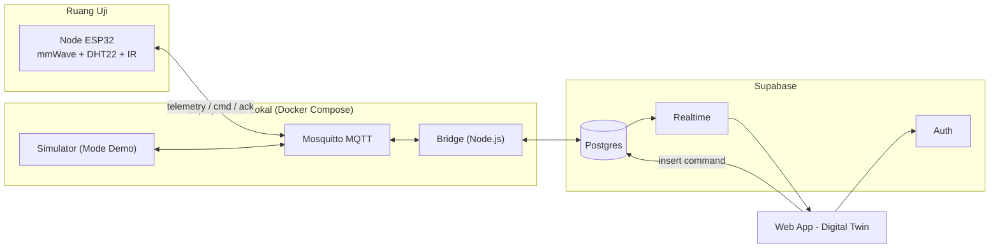
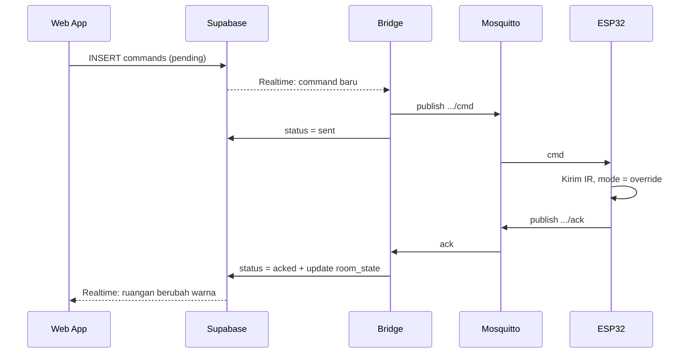

# Product Requirements Document (PRD): Acoptimizer

| | |
|---|---|
| **Project** | Acoptimizer — FST Smart Climate Control |
| **Judul Capstone** | Sistem Otomasi dan Pemantauan Efisiensi Energi Ruang Kelas Berbasis IoT Menggunakan Sensor Fusion (mmWave dan Suhu) pada FST UIN Syarif Hidayatullah Jakarta |
| **Versi** | v1.2 (Draft) — disesuaikan dengan proposal *Kerangka Berpikir* & rencana booth showcase |
| **Target Pembaca** | Tim Capstone, Dosen Pengampu, AI Agent |
| **Dokumen Terkait** | [implementation-plan.md](./implementation-plan.md), [progress-and-todo.md](./progress-and-todo.md), [Kerangka Berpikir.drawio.pdf](./Kerangka%20Berpikir.drawio.pdf) |

---

## 1. Executive Summary

Ruang kelas di FST sering kosong dengan AC (dan lampu) tetap menyala. Petugas memang berpatroli pukul **16.00–19.00** dari lantai atas ke bawah, tetapi jeda antara kelas yang mendadak kosong hingga patroli tiba tetap menimbulkan pemborosan. Petugas juga tidak tahu status aktual ruangan (kosong karena tidak ada jadwal, pindah ruang, kelas digabung, atau hanya ditinggal sementara).

Wawancara dengan Pak Eko (penanggung jawab lantai 2 FST) juga mengungkap **risiko keselamatan**: ada kasus mahasiswa terkunci di sekretariat dan tertidur di mushola hingga pagi.

**Acoptimizer** menjawab keduanya:
1. **Node IoT per ruangan** (ESP32 + radar mmWave + DHT22 + IR Blaster) — mendeteksi kehadiran tanpa kamera (menjaga privasi) dan mengatur AC otomatis (Normal / Eco / Mati).
2. **Digital Twin Gedung FST (web app)** — visual 3D gedung yang bisa di-drag, zoom, dan pinch; fokus per lantai; status tiap ruangan real-time; *remote override*; dan peringatan bila ada orang di ruangan di luar jam operasional.

> **Lingkup capstone:** perangkat dipasang di **1 ruangan uji coba**, tetapi sistem dirancang **berlaku untuk semua ruangan di setiap lantai**. Web app memetakan **seluruh gedung**: ruangan lain tampil sebagai "belum terpasang", atau sebagai data simulasi dalam **Mode Demo** saat booth.

---

## 2. Problem Statement

| # | Masalah | Dampak |
|---|---|---|
| P1 | **Pemborosan energi** — AC tidak dimatikan setelah kelas selesai. | Tagihan listrik tinggi, umur AC berkurang. |
| P2 | **Patroli manual tidak efisien** — penyisiran 16.00–19.00 dari lantai atas ke bawah. | Celah waktu pemborosan; tenaga petugas terbuang. |
| P3 | **Tidak ada visibilitas** status aktual ruangan. | Petugas tidak tahu ruangan mana yang perlu dicek. |
| P4 | **Risiko keselamatan** — orang tertinggal/terkunci di ruangan setelah jam operasional. | Insiden mahasiswa terjebak hingga pagi. |

**Rumusan masalah (proposal):**
1. Bagaimana mendeteksi kehadiran secara presisi (termasuk saat diam) tanpa kamera?
2. Bagaimana membangun otomasi yang mematikan AC secara mandiri saat ruangan kosong?
3. Bagaimana menyajikan telemetri ruangan secara real-time agar mudah dipantau petugas & IT Support?

---

## 3. Goals & Non-Goals

### Goals
- **G1** — Otomasi AC 3 tingkat (Normal 22°C / Eco 27°C / Mati) berdasarkan kehadiran, durasi kosong, suhu, dan jam (§6).
- **G2** — Visualisasi **seluruh gedung FST** secara 3D interaktif dengan status real-time (≤ 2 detik).
- **G3** — Peringatan dini: **ada orang di luar jam operasional** & **anomali AC** (ada orang tetapi ruangan panas).
- **G4** — *Remote override* dari web dengan konfirmasi dari alat.
- **G5** — Siap dipamerkan di **booth showcase**: mode kiosk, Mode Demo, dan tetap stabil tanpa internet kampus.

### Non-Goals (di luar capstone)
- Kontrol lampu (disebut di latar belakang, tetapi tidak dikerjakan di MVP).
- Pengukuran daya listrik aktual (memakai estimasi).
- Pemasangan di lebih dari 1 ruangan fisik.
- Integrasi SIAKAD/jadwal kuliah dan aplikasi mobile native.

---

## 4. Personas, Roles & Tim

| Persona | Role | Kebutuhan |
|---|---|---|
| **Petugas Gedung / IT Support** (primary) | `operator` | Melihat ruangan mana yang perlu dicek tanpa patroli, override AC, peringatan orang tertinggal. |
| **Manajemen Fakultas** | `manager` | Ringkasan penghematan energi. Read-only. |
| **Pengunjung Booth / Juri** | `viewer` (akun demo) | Memahami sistem dalam < 1 menit melalui visual gedung. Read-only. |
| **Tim Teknis** | `admin` | Mengelola ruangan, denah, perangkat, & parameter. |

| Anggota | Peran | Area di Proyek |
|---|---|---|
| Muhammad Rifqi Rahman | Web Developer | Web app (Digital Twin, dashboard) |
| Muhammad Ulil Albab | IoT Hardware Engineer | Perakitan, kalibrasi mmWave, IR |
| Irsyad Ariq | IoT Hardware Engineer | Perakitan, kalibrasi mmWave, IR |
| Almarino Fawwaz Amanu | Backend & Data Engineer | MQTT broker, bridge, Supabase |
| Sulthan Ahmad Marham | QA / System Tester | Uji integrasi end-to-end |

---

## 5. Konsep Inti: Status Ruangan

### 5.1 State AC
| `ac_mode` | Arti | Estimasi daya |
|---|---|---|
| `normal` | AC nyala, set 22°C | 100% rating |
| `eco` | AC nyala, set 27°C | ±60% rating (asumsi, dikalibrasi saat uji) |
| `off` | AC mati | 0 |

### 5.2 Status Ruangan di Dashboard (diturunkan dari data terakhir)
Urutan prioritas dari atas ke bawah. Status pertama yang cocok yang dipakai.

| Status | Kondisi | Warna | Label UI |
|---|---|---|---|
| `NO_DEVICE` | Ruangan belum dipasangi node | Outline putih (clay) | Belum terpasang |
| `OFFLINE` | Tidak ada laporan > 90 detik | Abu gelap + arsir | Offline |
| `AFTER_HOURS_OCCUPIED` | Ada orang **di luar jam operasional** (≥ 18.00) | 🟣 Ungu, berdenyut | ⚠️ Ada orang di luar jam |
| `ANOMALY` | Ada orang & suhu > 29°C | 🟠 Oranye | ⚠️ AC mati/rusak? |
| `OCCUPIED` | Ada orang, AC normal | 🟢 Hijau | Terpakai · AC Normal |
| `TRANSITION` | Kosong < 15 menit, AC belum diubah | 🟡 Kuning muda | Transisi |
| `ECO` | Kosong ≥ 15 menit, AC eco | 🔵 Biru | Kosong · Eco |
| `WASTE` | Kosong & AC masih `normal` ≥ 15 menit, atau di luar jam & AC belum `off` | 🔴 Merah | Pemborosan |
| `IDLE` | Kosong, AC mati | ⚪ Abu muda | Kosong · AC Mati |

Badge tambahan: **`OVERRIDE`** (dikendalikan manual + sisa waktu) dan **`DEMO`** (data simulasi).

**Mode perangkat:** `auto` (default) · `override` (manual sampai `override_until`) · `monitor` (tidak mengirim IR, untuk baseline).

---

## 6. Logika Otomasi (dari Proposal)

Jam operasional diambil dari NTP. Batas default: **18.00**.

| # | Waktu | Kehadiran | Durasi Kosong | Suhu | Aksi IR | Status Dashboard | Catatan |
|---|---|---|---|---|---|---|---|
| 1 | Jam kerja | Ada | — | < 26°C | Set **Normal 22°C** | Terpakai | Kondisi ideal |
| 2 | Jam kerja | Kosong | < 15 mnt | < 26°C | Tidak ada | Transisi | Cegah *short-cycling* kompresor (jeda toilet/ganti dosen) |
| 3 | Jam kerja | Kosong | ≥ 15 mnt | < 26°C | Set **Eco 27°C** | Kosong · Eco | Hemat tanpa membuat ruangan pengap |
| 4 | Jam kerja | Kosong | ≥ 2 jam | < 26°C | **Power OFF** | Kosong · AC Mati | Kelas tidak dipakai lama |
| 5 | Luar jam | Kosong | ≥ 15 mnt | bebas | **Power OFF** | Kosong · AC Mati | Sinergi dengan patroli malam |
| 6 | Luar jam | Ada | — | < 26°C | Set **Normal 22°C** | ⚠️ Ada orang di luar jam | Lembur/rapat himpunan, **notifikasi petugas** (aspek keselamatan) |
| 7 | Kapan saja | Kosong | ≥ 15 mnt | > 29°C | Tidak ada | Kosong · AC Mati (tervalidasi) | *Spam prevention*: suhu panas = bukti AC sudah mati |
| 8 | Kapan saja | Ada | — | > 29°C | Tidak ada | ⚠️ Anomali | AC mungkin dimatikan manual/rusak, **notifikasi petugas** |

> **Catatan desain:** Kasus 1 dan 6 ("< 26°C") perlu diperjelas. Jika ada orang dan suhu 26–29°C, usulan default adalah **Set Normal** juga. Keputusan final ada di tim hardware, dan logika yang sama harus dipakai di firmware **dan** simulator.

---

## 7. Functional Requirements

### A. Node IoT
| ID | Requirement |
|---|---|
| HW-1 | Deteksi kehadiran dengan HLK-LD2410 (termasuk orang diam). |
| HW-2 | Baca suhu & kelembapan (DHT22). |
| HW-3 | Jalankan logika otomasi §6 secara lokal (tetap berjalan saat offline). |
| HW-4 | Kirim telemetri saat berubah + heartbeat tiap **30 detik** (sesuai estimasi proposal ±1.200 baris/hari/ruangan). |
| HW-5 | Terima perintah override (`ac_normal` / `ac_eco` / `ac_off` / `release` + durasi) dan kirim **ack**. |
| HW-6 | LED indikator di luar ruangan (hijau = terpakai, merah = mengirim IR / peringatan). |

### B. Web App — Digital Twin Gedung
| ID | Requirement | Prioritas |
|---|---|---|
| WEB-1 | **Building View (3D)**: model gedung FST bertingkat, bisa **drag** (orbit), **zoom** (scroll/tombol), **pinch** & two-finger pan (touch). Tiap lantai menampilkan ruangan berwarna sesuai status. | P0 |
| WEB-2 | **Floor Focus**: klik lantai (di model atau di *floor chip*) → animasi kamera ke lantai tersebut; lantai di atasnya terangkat/memudar; tampil denah lantai dengan label ruangan & pin perangkat. Tombol kembali/`Esc` → Building View. | P0 |
| WEB-3 | **Room Sheet**: klik ruangan → panel detail (status, suhu, kelembapan, kehadiran + durasi, mode AC, *last seen*, grafik 6 jam, tombol override). | P0 |
| WEB-4 | **Summary chips**: jumlah per status di level gedung/lantai; klik chip menyorot ruangan terkait. | P0 |
| WEB-5 | **Layer switcher** (ala SmartThings Map View): `Status` · `Suhu` (heatmap gradasi 18–35°C) · `Kehadiran` · `Energi` (estimasi kW). | P1 |
| WEB-6 | **Remote override**: Normal / Eco / Matikan / Kembali ke Auto, durasi, konfirmasi, status perintah (*pending → sent → acked / failed*). Hanya `operator`/`admin`. | P0 |
| WEB-7 | **Alert real-time**: toast + feed untuk `AFTER_HOURS_OCCUPIED`, `ANOMALY`, `WASTE`, `OFFLINE`; klik alert → kamera terbang ke ruangan. | P0 |
| WEB-8 | **2D fallback**: toggle 2D/3D; otomatis 2D jika WebGL tidak tersedia atau `prefers-reduced-motion`. | P1 |
| WEB-9 | **Deep link**: URL mencerminkan state (`/?floor=4&room=4.03`); tombol back browser berfungsi. | P1 |
| WEB-10 | **Mode Pameran (Kiosk)**: layar penuh, auto-rotate gedung saat idle 60 detik, ringkasan cerita (problem → solusi), QR code agar pengunjung bisa membuka di HP. | P1 |
| WEB-11 | **Mode Demo**: ruangan tanpa perangkat diisi data simulator (badge `DEMO`); panel skenario untuk presentasi ("Kelas kosong 15 menit", "Ada orang jam 20.00", "AC rusak") dengan percepatan waktu. | P1 |
| WEB-12 | **Login & role** (Supabase Auth). Akun `viewer` untuk booth. | P0 |
| WEB-13 | **Laporan sederhana**: jam AC per mode, jam pemborosan, estimasi kWh & Rupiah, ekspor CSV. | P2 |
| WEB-14 | **Pengaturan (admin)**: data ruangan, perangkat, jam operasional, ambang suhu & durasi. | P2 |

### Visual Reference
Gaya visual: **Samsung SmartThings / One UI**. Latar terang hangat, kartu putih membulat besar, model *clay* putih bersih, warna status lembut, tipografi tebal & lega.

| Building View | Floor Focus |
|---|---|
|  |  |

*Mockup konsep (AI-generated). Bentuk gedung & denah final mengikuti denah asli FST.*

---

## 8. Non-Functional Requirements

| Kategori | Requirement |
|---|---|
| **Performa 3D** | ≥ 50 FPS di laptop booth (iGPU); render *on demand*; bundle 3D di-*lazy load*; TTI < 3 detik. |
| **Latensi** | Perubahan state tampil ≤ 2 detik; override sampai ke alat ≤ 3 detik (p95). |
| **Touch** | Semua gesture (orbit, pinch-zoom, pan, tap) berfungsi di layar sentuh/tablet; target sentuh ≥ 44 px. |
| **Keamanan** | RLS di semua tabel; `service_role` hanya di bridge; broker MQTT pakai autentikasi. |
| **Booth resilience** | Bisa berjalan di jaringan hotspot sendiri; Mode Demo tetap berjalan bila node fisik bermasalah. |
| **Privasi** | Tanpa kamera; hanya data biner kehadiran, suhu, dan kelembapan. |
| **Platform** | Browser modern di Windows/Linux (PC petugas) & tablet. Bahasa Indonesia, zona `Asia/Jakarta`. |
| **Aksesibilitas** | Status selalu punya label teks/ikon (tidak hanya warna); navigasi keyboard di 2D view & panel. |

---

## 9. High-Level Architecture

Mengikuti proposal: **MQTT broker di Docker (server lokal)** → Supabase → dashboard web.

### Alur Remote Override

Ack tidak diterima dalam 10 detik → `failed`.

---

## 10. Data Contract (MQTT)

Prefix: `acoptimizer/v1/{room_code}/...` (contoh `room_code`: `4.03`; titik diganti `-` di topik → `4-03`).

| Topik | Arah | Payload | QoS / Retain |
|---|---|---|---|
| `.../telemetry` | Node → | `{"device_id":"esp32-01","temp":26.5,"hum":60,"presence":true,"ac_mode":"normal","mode":"auto","override_until":null,"rule":1,"rssi":-61,"fw":"0.1.0"}` | 0 |
| `.../status` | Node → | `"online"` / `"offline"` (Last Will) | 1, retained |
| `.../cmd` | → Node | `{"cmd_id":"uuid","action":"ac_normal\|ac_eco\|ac_off\|release","duration_min":60}` | 1 |
| `.../ack` | Node → | `{"cmd_id":"uuid","ok":true,"ac_mode":"off","error":null}` | 1 |

`rule` = nomor kasus §6 yang sedang aktif. Nilai ini membantu QA dan bisa ditampilkan sebagai penjelasan di Room Sheet ("Kenapa AC Eco? → Kosong ≥ 15 menit").

---

## 11. Success Metrics

| KPI | Target | Cara Ukur |
|---|---|---|
| **Waste Reduction** (ruang uji) | Jam AC nyala saat kosong turun ≥ 60% | Baseline mode `monitor` vs. mode `auto` |
| **Akurasi Kehadiran** | ≥ 95% cocok dengan observasi manual, 0 false-empty saat orang duduk diam | Uji QA terjadwal |
| **Uptime Node** | ≥ 95% heartbeat diterima pada jam operasional | `sensor_logs` |
| **Latensi Override** | p95 ≤ 3 detik | Tabel `commands` |
| **Booth** | Pengunjung paham alur sistem < 1 menit; 0 crash selama sesi pameran | Observasi & feedback |

---

## 12. Risiko & Mitigasi

| Risiko | Mitigasi |
|---|---|
| IR satu arah: alat tidak tahu pasti state AC; AC bisa diubah dengan remote asli. | Validasi via tren suhu (kasus 7 & 8); tampilkan "state diasumsikan". |
| Hardware belum lolos power-on test. | Web & bridge dikembangkan dengan simulator; kontrak data dikunci di §10. |
| Denah asli FST belum tersedia. | Mulai dengan denah perkiraan berbasis JSON; ganti saat denah resmi didapat (tanpa ubah kode). |
| Scope 3D terlalu besar untuk jadwal 5 minggu. | Bangun 2D floor plan dulu (fallback), 3D dibangun di atasnya dengan data yang sama; geometri prosedural (tanpa modeling Blender). |
| Wi-Fi kampus/booth tidak stabil atau ada captive portal. | Hotspot sendiri; broker lokal di laptop; Mode Demo sebagai cadangan. |
| Laptop booth lemah GPU. | Render on demand, DPR dibatasi, efek berat opsional, toggle 2D. |

---

## 13. Open Questions
1. Berapa jumlah lantai Gedung FST dan apakah ada **denah resmi** (PDF/foto) per lantai?
2. Ruangan mana yang dipakai untuk uji coba (lantai & kode ruang)?
3. Kapan tanggal booth/showcase? Apakah tersedia layar besar/touchscreen?
4. Supabase cloud (butuh internet) atau Supabase self-host di Docker (sepenuhnya lokal)?
5. Merk/tipe AC di ruang uji (untuk kode IR) dan daya rating (untuk estimasi energi)?