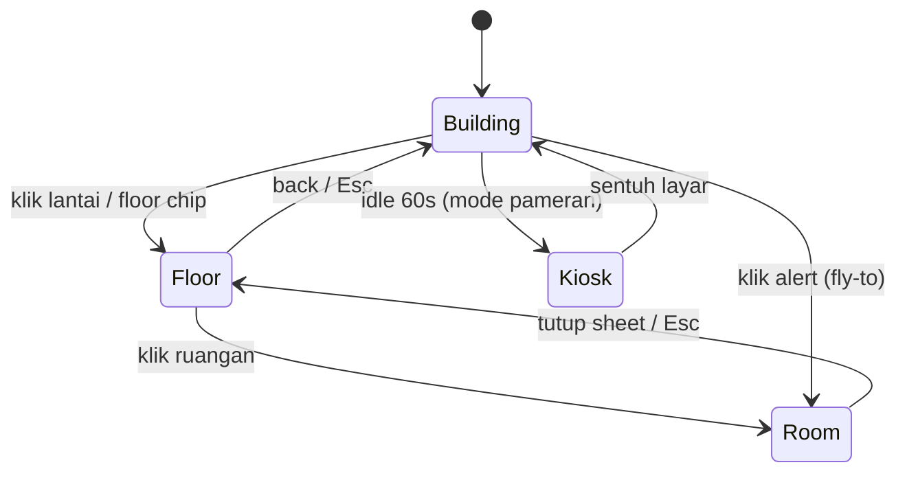

# 🚀 Implementation Plan: Acoptimizer

> Acuan produk: [PRD.md](./PRD.md) · Tracking: [progress-and-todo.md](./progress-and-todo.md)
>
> **Prinsip:**
> 1. Web app **tidak boleh terblokir hardware**: gunakan simulator yang mengikuti kontrak data yang sama dengan firmware.
> 2. **2D dulu, lalu 3D**: denah 2D dan 3D memakai satu sumber data geometri (`building.json`), sehingga 2D sekaligus menjadi fallback.
> 3. **Booth-ready**: semua bisa berjalan lokal (Docker Compose + hotspot), dengan Mode Demo sebagai cadangan.

---

## Ringkasan Fase

| Fase | Nama | PIC | Tergantung | Output |
|---|---|---|---|---|
| 0 | Fondasi Repo & Kontrak | Semua | — | Monorepo, `docs/mqtt-contract.md`, `building.json` v0 |
| 1 | Supabase Schema & Security | Almarino | 0 | Migrasi, RLS, Realtime, seed |
| 2 | Broker, Bridge & Simulator | Almarino (+Rifqi untuk simulator) | 1 | Docker Compose lokal, data hidup tanpa hardware |
| **3** | **Web App — Digital Twin** | **Rifqi** | 1, 2 | Dashboard 3D siap booth |
| 4 | Firmware ESP32 | Ulil, Irsyad | 0, hardware OK | Node sesuai kontrak & logika §6 PRD |
| 5 | QA, Pilot & Booth | Sulthan + Semua | 2, 3, 4 | Laporan uji, baseline vs. auto, rehearsal booth |

### Pemetaan ke Jadwal Proposal (5 minggu)
| Minggu | Proposal | Fokus Web (Rifqi) |
|---|---|---|
| 1 | Persiapan & perakitan | Fase 0: kontrak data, `building.json` v0 |
| 2 | Infrastruktur backend | W1–W3: scaffold, auth, data layer + simulator |
| 3 | Pengembangan frontend | W4–W6: 2D floor plan, 3D building, floor focus, room sheet |
| 4 | Otomasi & pengujian | W7–W8: override, alert, layer, integrasi node asli |
| 5 | Finalisasi & pelaporan | W9–W10: Mode Pameran, Mode Demo, polish, rehearsal booth |

---

## Tech Stack

| Layer | Pilihan | Alasan |
|---|---|---|
| Frontend | **Vite + React 19 + TypeScript** | SPA berat 3D tidak butuh SSR; build cepat; sesuai opsi "Vite/Next.js" di proposal. |
| 3D | **three + @react-three/fiber + @react-three/drei** | Deklaratif di React; `CameraControls` (drag/zoom/pinch/pan + transisi halus), `Html` label, `ContactShadows`, `Bounds`. |
| Animasi | `maath/easing` (3D), Motion (`motion/react`) untuk UI | Transisi lantai & panel yang halus. |
| Styling/UI | Tailwind CSS v4 + shadcn/ui | Sesuai proposal (Tailwind); shadcn untuk Sheet, Dialog, Tabs, Sonner, Chart. |
| State | TanStack Query v5 (server state) + Zustand (view state: mode, lantai, ruangan, layer) | Pemisahan jelas data vs. kamera/UI. |
| Routing | React Router v7 | Deep link `?floor=&room=`. |
| Charts | Recharts (shadcn Chart) | |
| Backend | Supabase (Postgres, Auth, Realtime, pg_cron) | |
| Broker | **Mosquitto di Docker** (auth username/password) | Sesuai proposal (server lokal). |
| Bridge & Simulator | Node.js 20 + TS, `mqtt`, `@supabase/supabase-js`, `zod` | Satu `docker compose up` untuk booth. |
| Firmware | Arduino/PlatformIO: `PubSubClient`, `ArduinoJson`, `DHT`, `IRremoteESP8266`, NTP | |

---

## Phase 0 — Fondasi Repo & Kontrak

```
acoptimizer/
├── PRD.md · implementation-plan.md · progress-and-todo.md
├── docs/
│   ├── mqtt-contract.md         # sumber kebenaran topik & payload
│   ├── automation-rules.md      # tabel logika §6 PRD + test cases
│   └── mockups/
├── infra/
│   ├── docker-compose.yml       # mosquitto + bridge + simulator
│   └── mosquitto/ (mosquitto.conf, passwd)
├── supabase/ (migrations/, seed.sql)
├── packages/
│   └── shared/                  # tipe payload (zod), deriveRoomStatus, automation rules (dipakai simulator & web)
├── bridge/
├── simulator/
├── web/
└── firmware/
```

- [ ] Inisialisasi monorepo (npm workspaces) + `.gitignore` + `.env.example` per paket.
- [ ] `docs/mqtt-contract.md` & `docs/automation-rules.md` disepakati tim hardware + backend.
- [ ] `packages/shared`: skema zod payload + fungsi `evaluateAutomation(input) → { acMode, rule }` (port dari tabel §6) + unit test semua 8 kasus. Firmware wajib meniru hasil test ini.
- [ ] **`web/src/data/building.json` v0** (lihat §3.3): denah perkiraan seluruh lantai FST, nanti diganti denah resmi.

---

## Phase 1 — Supabase Schema & Security

### 1.1 Skema (`0001_init.sql`)
```sql
create type public.user_role as enum ('admin', 'operator', 'manager', 'viewer');
create type public.ac_mode   as enum ('normal', 'eco', 'off');
create type public.device_mode as enum ('auto', 'override', 'monitor');

create table public.profiles (
  id uuid primary key references auth.users on delete cascade,
  full_name text,
  role public.user_role not null default 'viewer',
  created_at timestamptz not null default now()
);

-- Data operasional ruangan. Geometri ada di building.json, di-join via `code`.
create table public.rooms (
  id          uuid primary key default gen_random_uuid(),
  code        text not null unique,          -- '4.03' (sama dengan building.json)
  name        text not null,                 -- 'Kelas 4.03'
  floor       smallint not null,
  kind        text not null default 'classroom'
              check (kind in ('classroom','lab','office','mushola','secretariat','other')),
  ac_power_kw numeric(4,2) not null default 1.20,
  device_id   text unique,                   -- null = belum terpasang (NO_DEVICE)
  is_active   boolean not null default true,
  created_at  timestamptz not null default now()
);

create table public.room_state (
  room_id             uuid primary key references public.rooms on delete cascade,
  online              boolean not null default false,
  is_demo             boolean not null default false,   -- data dari simulator
  presence            boolean,
  temperature         numeric(4,1),
  humidity            numeric(4,1),
  ac_mode             public.ac_mode,
  mode                public.device_mode not null default 'auto',
  rule                smallint,                          -- kasus otomasi aktif (1–8)
  override_until      timestamptz,
  presence_changed_at timestamptz,
  ac_changed_at       timestamptz,
  rssi                int,
  firmware_version    text,
  last_seen           timestamptz,
  updated_at          timestamptz not null default now()
);

create table public.sensor_logs (
  id          bigint generated always as identity primary key,
  room_id     uuid not null references public.rooms on delete cascade,
  recorded_at timestamptz not null default now(),
  temperature numeric(4,1),
  humidity    numeric(4,1),
  presence    boolean,
  ac_mode     public.ac_mode,
  rule        smallint,
  is_demo     boolean not null default false
);
create index on public.sensor_logs (room_id, recorded_at desc);

create type public.command_action as enum ('ac_normal', 'ac_eco', 'ac_off', 'release');
create type public.command_status as enum ('pending', 'sent', 'acked', 'failed', 'expired');

create table public.commands (
  id           uuid primary key default gen_random_uuid(),
  room_id      uuid not null references public.rooms on delete cascade,
  action       public.command_action not null,
  duration_min int not null default 60 check (duration_min between 5 and 720),
  reason       text,
  status       public.command_status not null default 'pending',
  requested_by uuid not null default auth.uid() references auth.users,
  created_at   timestamptz not null default now(),
  sent_at      timestamptz,
  acked_at     timestamptz,
  error        text
);

create table public.alerts (
  id          bigint generated always as identity primary key,
  room_id     uuid not null references public.rooms on delete cascade,
  type        text not null check (type in ('after_hours_occupied','anomaly','waste','offline')),
  started_at  timestamptz not null default now(),
  resolved_at timestamptz,
  acknowledged_by uuid references auth.users,
  is_demo     boolean not null default false
);

create table public.settings (key text primary key, value jsonb not null);
```

### 1.2 Security (`0002_rls.sql`)
- [ ] `current_user_role()` (security definer) + trigger auto-create `profiles`.
- [ ] RLS semua tabel:

| Tabel | SELECT | INSERT/UPDATE |
|---|---|---|
| `rooms`, `settings` | authenticated | admin |
| `room_state`, `sensor_logs` | authenticated | bridge (service_role) |
| `commands` | authenticated | INSERT: operator/admin (`requested_by = auth.uid()`); UPDATE: bridge |
| `alerts` | authenticated | bridge; UPDATE `acknowledged_by`: operator/admin |
| `profiles` | diri sendiri / admin | admin |

### 1.3 Realtime & Jobs (`0003_realtime.sql`)
- [ ] Publication `supabase_realtime`: `room_state`, `commands`, `alerts` (bukan `sensor_logs`).
- [ ] pg_cron: tandai `commands` tanpa ack > 10 detik → `failed`; hapus `sensor_logs` demo > 7 hari & asli > 90 hari.

### 1.4 Seed
- [ ] Semua ruangan dari `building.json` dimasukkan ke `rooms`; **1 ruangan uji** diberi `device_id`.
- [ ] `settings`: `operating_hours_end: "18:00"`, `grace_min: 15`, `long_empty_min: 120`, `hot_temp_c: 29`, `offline_after_sec: 90`, `tariff_per_kwh`, `eco_power_ratio: 0.6`.
- [ ] Akun: admin, operator, manager, `booth@acoptimizer` (viewer).

**DoD:** `supabase db reset` sukses; tipe TS digenerate ke `packages/shared/src/database.ts`; viewer tidak bisa INSERT command.

---

## Phase 2 — Broker, Bridge & Simulator (Docker Compose)

### 2.1 Mosquitto
- [ ] `infra/mosquitto/mosquitto.conf`: listener 1883 (LAN) + 9001 (websocket, opsional), `allow_anonymous false`, akun `device`, `bridge`, `simulator`.
- [ ] Dokumentasikan IP statis laptop pada hotspot booth (ESP32 menunjuk ke IP ini).

### 2.2 Bridge
- [ ] Subscribe `acoptimizer/v1/+/telemetry|status|ack`, validasi zod.
- [ ] Telemetri → upsert `room_state` (+`*_changed_at` hanya saat berubah) & insert `sensor_logs`.
- [ ] Hitung status dengan `deriveRoomStatus` (shared) → buka/tutup baris `alerts` saat status masuk/keluar kategori alert.
- [ ] Realtime `INSERT commands` → publish `.../cmd` → `sent`; ack → `acked`; timeout → `failed`. Saat start, proses command `pending` yang tertinggal.
- [ ] Reconnect otomatis, log terstruktur, `/health`.

### 2.3 Simulator (Mode Demo)
- [ ] Mensimulasikan semua ruangan **tanpa** `device_id` (atau daftar via CLI), payload diberi flag demo (topik `acoptimizer/v1/demo/{room}/...` → bridge set `is_demo = true`).
- [ ] Memakai `evaluateAutomation` dari `packages/shared` (logika identik firmware).
- [ ] Jadwal kuliah sintetis per lantai, suhu bereaksi terhadap mode AC, `--speed` percepatan waktu.
- [ ] **Skenario on-demand** (dipicu dari web via tabel `settings`/channel broadcast): `empty_15m`, `after_hours_person`, `ac_broken`, `node_offline` pada ruangan tertentu.
- [ ] Merespons `cmd` dengan ack.

**DoD:** `docker compose up` → seluruh gedung "hidup" di Supabase ≤ 1 menit; command dari SQL di-ack simulator.

---

## Phase 3 — Web App: Digital Twin (FOKUS)

### 3.1 Konsep Interaksi



| Mode | Kamera | Visual |
|---|---|---|
| **Building** | Orbit bebas (azimuth 360°, polar 25°–75°), zoom 0.6×–2.5×, damping | Semua lantai sedikit terpisah (exploded 0.4 m); ruangan diwarnai status; fasad kaca semi-transparan; ground contact shadow. |
| **Floor** | `fitToBox(lantai)` dengan tilt ±55°, orbit dibatasi ±30°, pan aktif | Lantai di atas naik +8 m & fade ke 0; lantai bawah fade ke 0.15; label ruangan (`Html`), pin perangkat, heatmap sesuai layer. |
| **Room** | Zoom ringan ke ruangan, sheet terbuka di kanan (bawah di mobile) | Outline ruangan terpilih; ruangan lain sedikit diredupkan. |

Gesture: **drag** = orbit · **scroll/pinch** = zoom · **right-drag / two-finger** = pan · **tap** = pilih · **double-tap** = fokus. Tersedia tombol +/−/reset/2D-3D untuk aksesibilitas.

### 3.2 Struktur Proyek
```
web/src/
├── main.tsx · App.tsx · router.tsx · index.css (tokens One UI-like)
├── data/building.json                # geometri gedung (sumber tunggal 2D & 3D)
├── lib/ (supabase.ts, format.ts, geometry.ts, colorScales.ts)
├── stores/viewStore.ts               # zustand: mode, floor, room, layer, kiosk, demo
├── hooks/
│   ├── useRooms.ts                   # rooms + room_state + realtime → Map<code, RoomView>
│   ├── useNow.ts · useRealtimeStatus.ts · useAlerts.ts
│   ├── useRoomHistory.ts · useCommands.ts · useIdle.ts
├── features/
│   ├── twin3d/
│   │   ├── TwinCanvas.tsx            # <Canvas frameloop="demand" dpr={[1,2]}>, lazy loaded
│   │   ├── CameraRig.tsx             # CameraControls + transisi per mode
│   │   ├── Building.tsx · FloorSlab.tsx · RoomMesh.tsx · Walls.tsx · Facade.tsx
│   │   ├── RoomLabel.tsx · DevicePin.tsx · HeatGlow.tsx
│   │   └── Lighting.tsx              # hemi + directional soft, ContactShadows
│   ├── plan2d/ (FloorPlanSvg.tsx, RoomShape.tsx)     # fallback & mobile kecil
│   ├── hud/ (TopBar, SummaryChips, FloorRail, LayerSwitcher, MapControls, Legend, ConnectionPill)
│   ├── room/ (RoomSheet, RoomStats, RoomHistoryChart, RuleExplainer, OverrideControls, CommandStatus)
│   ├── alerts/ (AlertToaster, AlertFeed)
│   ├── kiosk/ (KioskOverlay, StoryCards, QrCard, AttractLoop)
│   └── demo/ (DemoPanel, ScenarioButtons)
└── pages/ (LoginPage, TwinPage "/", ReportsPage, SettingsPage)
```

### 3.3 Format `building.json`
Satuan meter; denah per lantai sebagai poligon. Geometri 3D dibuat **prosedural** (extrude), tanpa file model 3D.
```json
{
  "name": "Gedung FST",
  "floorHeight": 3.6,
  "floors": [
    {
      "level": 4,
      "label": "Lantai 4",
      "outline": [[0,0],[48,0],[48,18],[0,18]],
      "rooms": [
        { "code": "4.01", "name": "Kelas 4.01", "kind": "classroom", "polygon": [[0,0],[12,0],[12,7],[0,7]], "devicePos": [6,3.5] },
        { "code": "4.03", "name": "Kelas 4.03", "kind": "classroom", "polygon": [[24,0],[36,0],[36,7],[24,7]], "devicePos": [30,3.5] },
        { "code": "4.MUS", "name": "Mushola", "kind": "mushola", "polygon": [[24,11],[32,11],[32,18],[24,18]] }
      ],
      "corridors": [ [[0,7],[48,7],[48,11],[0,11]] ]
    }
  ]
}
```
- `geometry.ts`: poligon → `THREE.Shape` → lantai (extrude 0.2 m), dinding (offset garis tepi, tinggi 1.2 m di mode Floor agar "cutaway" seperti mockup), isi ruangan (plane berwarna).
- Ruangan non-AC (mushola, sekretariat) tetap ditampilkan karena relevan untuk deteksi **orang tertinggal**.

### 3.4 Pola Data & Status
1. `useRooms`: fetch `rooms` + `room_state` (TanStack Query) → subscribe `postgres_changes` `room_state` → `setQueryData` per baris; re-sync saat reconnect.
2. Gabungkan dengan `building.json` via `code` → `RoomView { geometry, state, status }`.
3. `status = deriveRoomStatus(state, settings, now)` dari `packages/shared` (prioritas sesuai PRD §5.2). `useNow` tick tiap 5 detik agar `OFFLINE`/`WASTE`/`AFTER_HOURS` berubah tanpa event baru.
4. Warna per layer di `colorScales.ts`: `status → token`, `temp → gradient 18–35°C`, `presence → hijau/abu`, `energy → kW estimasi`.
5. Komponen 3D membaca warna via selector Zustand/Query (hindari re-render seluruh Canvas); panggil `invalidate()` saat data berubah (frameloop on-demand).

### 3.5 Design Tokens (One UI-like)
```css
:root {
  --bg: #F4F5F7; --surface: #FFFFFF; --text: #0B0B0F; --muted: #6B7280;
  --radius-card: 28px; --radius-pill: 999px; --shadow-soft: 0 8px 30px rgb(0 0 0 / .06);
  --st-occupied: #8FD3A0; --st-transition: #F6D98B; --st-eco: #9DBEF2; --st-idle: #E5E7EB;
  --st-waste: #F28B82;    --st-anomaly: #F5B072;    --st-afterhours: #B79CF2;
  --st-offline: #6B7280;  --clay: #FAFAFA;
  --font: "One UI Sans", "Inter", system-ui, sans-serif;
}
```
Dark mode menyusul (P2), penting untuk kiosk di ruangan terang/gelap.

### 3.6 Milestones

| # | Milestone | Tasks | Definition of Done |
|---|---|---|---|
| W1 | **Scaffold & Tokens** | Vite React TS, Tailwind v4, shadcn init, alias, ESLint/Prettier, Vitest, tokens §3.5, font. | App shell tampil sesuai gaya mockup (tanpa data). |
| W2 | **Auth & Routing** | Login, `useAuth` + role, guard, akun viewer booth (auto-login via query `?kiosk=1` opsional). | Viewer tidak melihat tombol override. |
| W3 | **Data Layer** | `useRooms`, `useNow`, `useRealtimeStatus`, merge dengan `building.json`, Zustand store + sinkron URL. | Ubah `room_state` di SQL → state di devtools berubah ≤ 2 detik. |
| W4 | **2D Floor Plan** | `FloorPlanSvg` dari `building.json`, warna status, klik ruangan → `RoomSheet` dasar, `FloorRail`, `SummaryChips`. | Semua lantai bisa dijelajah dalam 2D; ini juga fallback. |
| W5 | **3D Building View** | `TwinCanvas` (lazy), geometri prosedural, lighting clay + ContactShadows, `CameraControls` drag/zoom/pinch/pan, `MapControls`. | ≥ 50 FPS di laptop booth; gesture jalan di touchscreen/tablet. |
| W6 | **Floor Focus & Room** | Transisi Building↔Floor (lift & fade, `fitToBox`), label & pin, highlight ruangan, `RoomSheet` lengkap + grafik + `RuleExplainer`. | Klik lantai → animasi ≤ 800 ms tanpa patah; Esc/back kembali; deep link berfungsi. |
| W7 | **Override & Alerts** | `OverrideControls` (Normal/Eco/Matikan/Auto + durasi + konfirmasi), `CommandStatus` realtime, `AlertToaster` + `AlertFeed`, klik alert → fly-to. | Override ke simulator & node asli ter-ack ≤ 3 detik; alert "ada orang di luar jam" muncul dan bisa di-acknowledge. |
| W8 | **Layers & Integrasi Node Asli** | `LayerSwitcher` (Status/Suhu/Kehadiran/Energi), `HeatGlow`, legend gradasi; uji dengan ESP32 di ruang uji. | Ruang uji tampil data asli (tanpa badge DEMO) berdampingan dengan ruangan demo. |
| W9 | **Mode Pameran & Demo** | `KioskOverlay` (fullscreen, attract loop auto-rotate, story cards Problem→Solusi→Dampak, QR), `DemoPanel` (skenario + speed). | Rehearsal 10 menit tanpa sentuhan operator tidak crash; skenario memicu perubahan visual ≤ 5 detik. |
| W10 | **Polish & Release** | Responsif tablet/HP (sheet bawah), reduced-motion → 2D, error boundary, Lighthouse, README, laporan sederhana (P2) & settings (P2) jika waktu cukup. | Lighthouse a11y ≥ 90; checklist booth (§5) lulus. |

### 3.7 Batas Scope (agar selesai tepat waktu)
- **Wajib booth:** W1–W7 + W9.
- **Bagus jika sempat:** layer Energi, HeatGlow, laporan, settings, dark mode.
- **Tidak dikerjakan:** model 3D detail (meja/kursi), editor denah visual, multi-gedung.

---

## Phase 4 — Firmware ESP32

- [ ] Prasyarat: power-on test & debugging selesai (lihat progress Phase 0 hardware).
- [ ] Rekam kode IR remote AC ruang uji (IRrecvDumpV2) untuk **Normal 22°C**, **Eco 27°C**, **OFF**.
- [ ] NTP (WIB) untuk penentuan jam kerja/luar jam.
- [ ] Implementasi tabel §6 PRD; hasil harus identik dengan test `evaluateAutomation` di `packages/shared`.
- [ ] Telemetri on-change + heartbeat 30 detik, Last Will, `cmd` + `ack`, field `rule`.
- [ ] Otomasi tetap berjalan saat Wi-Fi/broker putus; reconnect non-blocking.
- [ ] Kemas ke project box; LED indikator luar ruangan.

---

## Phase 5 — QA, Pilot & Booth

**QA (Sulthan)**
- [ ] Test matrix 8 kasus otomasi (firmware vs. simulator vs. dashboard).
- [ ] Uji akurasi mmWave: duduk diam 30 menit, tidur, keluar-masuk cepat.
- [ ] Uji latensi telemetri & override, uji reconnect (cabut Wi-Fi/broker).

**Pilot**
- [ ] 3–5 hari mode `monitor` (baseline) → 5–7 hari mode `auto` di ruang uji → hitung KPI.

**Checklist Booth**
- [ ] Laptop + hotspot sendiri; `docker compose up` + web build lokal (`vite preview`) berjalan tanpa internet kampus.
- [ ] Node ESP32 + AC/IR receiver demo di meja booth (atau video ruang uji sebagai cadangan).
- [ ] Layar besar/touchscreen; Mode Pameran aktif; QR ke versi web read-only.
- [ ] Skrip pitch 60 detik mengikuti story cards; skenario demo dilatih.
- [ ] Rencana cadangan: Mode Demo penuh jika node gagal.

---

## Konvensi untuk AI Agent / Kontributor
- Perubahan skema = migrasi baru; regenerate tipe TS.
- Perubahan kontrak/logika: update `docs/` → `packages/shared` (+test) → simulator/bridge/firmware.
- Geometri gedung hanya diubah di `building.json`.
- Jangan commit `.env`/`passwd`; sediakan contoh.
- Update [progress-and-todo.md](./progress-and-todo.md) setiap menyelesaikan task.