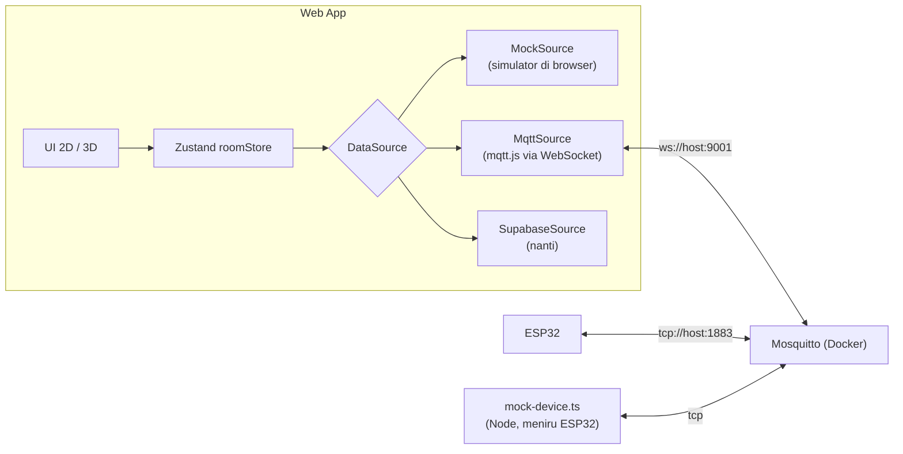

# 🖥️ Web Implementation Plan: Acoptimizer Digital Twin

> **Tujuan:** membangun web app *Digital Twin* Gedung FST yang **siap membaca data MQTT langsung dari perangkat IoT**. Selama hardware belum siap, web dikembangkan dengan *mock source*.
>
> Acuan: [PRD.md](./PRD.md) · [implementation-plan.md](./implementation-plan.md) · [docs/spesifikasi-gedung.md](./docs/spesifikasi-gedung.md)
>
> Cara pakai dokumen ini: kerjakan **berurutan**. Setiap step punya ✅ *cek selesai*. Jangan lanjut ke stage berikutnya sebelum semua cek di stage itu lulus.

---

## Daftar Isi
- [A. Keputusan Arsitektur](#a-keputusan-arsitektur)
- [B. Model Spasial Gedung FST](#b-model-spasial-gedung-fst)
- [C. Step-by-Step](#c-step-by-step)
  - Stage 0 Prasyarat · 1 Scaffold · 2 Domain & Kontrak · 3 Model Gedung · 4 Data Layer · 5 UI 2D · 6 3D Building · 7 Floor Focus · **8 Integrasi MQTT** · 9 Override & Alert · 10 Layer · 11 Kiosk & Demo · 12 Supabase (nanti) · 13 Release Booth
- [D. Handoff ke Tim Hardware](#d-handoff-ke-tim-hardware)
- [E. Open Questions](#e-open-questions)

---

## A. Keputusan Arsitektur

### A.1 Web membaca data lewat *Data Source Adapter*
Semua sumber data dibungkus satu interface yang sama. UI tidak tahu dan tidak peduli dari mana data datang.



| Source | Kapan dipakai | Kelebihan | Keterbatasan |
|---|---|---|---|
| `mock` | Stage 4–7 (sekarang) | Tanpa infrastruktur, bisa dikembangkan offline | Data palsu |
| `mqtt` | Stage 8+ & booth | **Langsung dari perangkat**, latensi rendah, tanpa backend | Riwayat hanya selama tab terbuka (ring buffer); belum ada audit log |
| `supabase` | Stage 12 (setelah backend siap) | Riwayat, auth, log override, laporan | Butuh bridge & internet |

Pilihan via env: `VITE_DATA_SOURCE=mock|mqtt|supabase`. Mode `hybrid` (MQTT untuk live + Supabase untuk riwayat) bisa ditambahkan di Stage 12.

> **Catatan:** browser tidak bisa membuka koneksi TCP MQTT biasa. Karena itu Mosquitto **wajib** membuka listener **WebSocket (port 9001)**. ESP32 tetap memakai TCP 1883.

### A.2 Tambahan pada kontrak MQTT (sinkron dengan PRD §10)
- `telemetry` dipublish dengan **`retain = true`** agar web langsung mendapat state terakhir saat dibuka (tanpa menunggu heartbeat 30 detik).
- `status` (`online`/`offline`) memakai **Last Will**, `retain = true`.
- Topik memakai **`slot` ruangan** (lihat §B.3), mis. `acoptimizer/v1/3-U1/telemetry`.
- Status ruangan (Terpakai/Eco/Waste/dll.) **dihitung di web** dengan jam browser (WIB). Payload `rule` dari ESP32 dipakai sebagai penjelasan.

### A.3 Stack
Vite + React 19 + TypeScript · Tailwind CSS v4 + shadcn/ui · three + @react-three/fiber + @react-three/drei · Zustand · zod · mqtt (mqtt.js v5) · Recharts · date-fns · Motion · Vitest + Testing Library · Playwright (smoke test).

---

## B. Model Spasial Gedung FST

Diterjemahkan dari [spesifikasi-gedung.md](./docs/spesifikasi-gedung.md). **Dimensi masih estimasi** dan dikalibrasi nanti (lihat Step 3.6).

### B.1 Fakta dari spesifikasi
| Aspek | Keterangan |
|---|---|
| Jumlah lantai | **7** |
| Tipologi | **Atrium**: void besar di tengah, setiap lantai melingkari void; dari Lt 7 terlihat sampai Lt 1. |
| Dasar void (Lt 1) | Taman & area berkumpul. |
| Sayap | **Utara & Selatan**: 3 ruang – *core* (lounge + tangga besar + 2 lift) – 3 ruang. **Barat & Timur**: ±5 ruang. |
| Core | Di tengah sayap utara & selatan: lobby/lounge, tangga besar *imperial* (1 tangga → bercabang kiri-kanan di bordes → menyatu lagi, berulang per lantai), 2 lift mengapit pintu kaca. |
| Toilet | 2 per lantai, di **pojok yang berseberangan diagonal**. |
| Lt 1 | 2 lobby resepsionis berseberangan (Sarjana Sainstek & Pascasarjana Ekonomi-Bisnis), pos satpam, mushola di pojok, kantin, lorong terbuka melingkar dengan meja-kursi. |
| Lt 2 | Administrasi: ruang WD, dekanat, dosen/staf, ruang sidang, mushola pria (besar), ruang teater. |
| Lt 3–7 | Ruang kelas, ruang dosen, staf, toilet. |

### B.2 Denah tipikal (Lt 3–7), tampak atas
```
                                   UTARA (Lobby Sarjana di Lt 1)
  ┌────────┬───────┬───────┬───────┬─────────────────┬───────┬───────┬───────┬────────┐
  │ Pojok  │  U1   │  U2   │  U3   │  CORE UTARA     │  U4   │  U5   │  U6   │  WC    │
  │  NW    │       │       │       │ tangga + 2 lift │       │       │       │  (NE)  │
  │        ├───────┴───────┴───────┤     LOUNGE      ├───────┴───────┴───────┤  +     │
  ├────┬───┘      koridor          └─────────────────┘        koridor        │ Tangga │
  │ B1 │ k ┌─────────────────────────────────────────────────────────────────┐│ Darurat│
  ├────┤ o │                                                                 │└───┬───┤
  │ B2 │ r │                                                                 │ k  │ T1 │
  ├────┤ i │                     VOID / ATRIUM                               │ o  ├────┤
B │ B3 │ d │           (Lt 1: taman & area berkumpul)                        │ r  │ T2 │ T
a ├────┤ o │                                                                 │ i  ├────┤ i
r │ B4 │ r │  (Buka pintu kelas -> langsung koridor menghadap void)          │ d  │ T3 │ m
a ├────┤   │                                                                 │ o  ├────┤ u
t │ B5 │   │                                                                 │ r  │ T4 │ r
  ├────┴───┐                                                                 │    ├────┤
  │  WC    │                                                                 │    │ T5 │
  │  (SW)  │                                                                 └───┬┴────┤
  │  +     │                                                                     │ Pojok│
  │ Tangga ├───────┬───────┬───────┬─────────────────┬───────┬───────┬───────┬───┤  SE  │
  │ Darurat│  S1   │  S2   │  S3   │  CORE SELATAN   │  S4   │  S5   │  S6   │   │      │
  │        │       │       │       │ tangga + 2 lift │       │       │       │   │      │
  └────────┴───────┴───────┴───────┴─────────────────┴───────┴───────┴───────┴───┴──────┘
                                  SELATAN (Lobby Pascasarjana di Lt 1)
```
**Klarifikasi Arsitektur & Spasial (Tervalidasi):**
1. **Posisi Koridor & Ruangan**: Ruangan berada di sisi terluar gedung. Begitu pintu kelas dibuka, pengguna langsung berada di koridor yang melingkari dan langsung melihat ke arah void / atrium tengah (dilengkapi railing).
2. **Toilet & Tangga Evakuasi**: Berada di pojok **Timur Laut (NE)** dan **Barat Daya (SW)** (berseberangan diagonal). Tepat di samping tiap toilet terdapat pintu evakuasi darurat yang mengarah ke **tangga samping/darurat** menerus dari lantai 7 sampai lantai 1 (total 2 tangga darurat samping, melengkapi tangga besar imperial di core tengah).
3. **Orientasi Lobby Lt 1**:
   - Sisi **Utara** = Lobby Program Sarjana Sains dan Teknologi (FST).
   - Sisi **Selatan** = Lobby Program Pascasarjana Ekonomi dan Bisnis.
4. **Pojok Lainnya**: Pojok NW dan SE difungsikan untuk ruang servis, teknisi/OB, atau ruang penunjang.

### B.3 Slot & kode ruangan
- Setiap posisi di denah adalah **slot spasial** dengan ID tetap: `{lantai}-{sayap}{nomor}`, sayap `U`/`T`/`S`/`B` (Utara/Timur/Selatan/Barat), mis. `3-U1`, `6-T2`.
- **Penomoran Ruang Resmi FST**: Menggunakan awalan nomor lantai diikuti 2 digit nomor ruang (contoh: **601, 602** di lantai 6; **701, 702** di lantai 7; **301** di lantai 3). Pemetaan ini diatur di `catalog.ts`:
  - `slot: "6-U1"` -> `displayName: "Ruang 601"`, `kind: "classroom"`
  - `slot: "6-U2"` -> `displayName: "Ruang 602"`, `kind: "classroom"`
- **Ruang Uji Coba Pilot**: Ditetapkan pada salah satu **Ruang Kelas** (default rekomendasi: `Ruang 601` / `slot: 6-U1` atau `Ruang 301` / `slot: 3-U1`). Ruang kelas lain diposisikan sebagai target ekspansi/simulasi demo.
- **Slot ID tetap dipakai di topik MQTT (`acoptimizer/v1/<slot>/...`)** demi konsistensi payload dan isolasi hardware dari perubahan penamaan ruangan.

Per lantai tipikal: **22 ruang** (6+6+5+5) + 2 toilet & tangga darurat (NE, SW) + 2 pojok servis (NW, SE) + 2 core (Utara & Selatan).

### B.4 Dimensi awal (estimasi, satuan meter)
| Parameter | Nilai awal | Keterangan |
|---|---|---|
| `footprint` | 64 × 56 | Lebar (B–T) × dalam (U–S) |
| `roomDepth` | 8 | Kedalaman ruang dari fasad ke koridor |
| `corridorWidth` | 3 | |
| `cornerSize` | 8 × 11 | Blok pojok (ruang + koridor) |
| `coreWidth` | 12 | Lounge + tangga + lift |
| `floorHeight` | 4.0 | Lt 1 = 5.0 (lobby lebih tinggi) |
| Lebar ruang U/S | 6 | 3 ruang × 6 m per sisi core |
| Lebar ruang B/T | 6.8 | 5 ruang mengisi 34 m |
| Void | ±42 × 34 | Hasil turunan dari parameter di atas |

### B.5 Penyederhanaan visual (agar tetap realistis dikerjakan)
| Elemen | MVP | Nanti (P2) |
|---|---|---|
| Ruang & koridor | Poligon extrude + dinding *cutaway* rendah | — |
| Void | Lubang di pelat lantai; Lt 1 berisi taman (pohon low-poly sederhana) | Bangku, kanopi |
| Core | Blok lift + blok tangga bergaya | Tangga *imperial* bercabang yang terlihat dari lounge |
| Fasad | Panel kaca semi-transparan di sisi luar | Mullion/kisi |
| Railing void | Garis kaca tipis | — |

---

## C. Step-by-Step

### Stage 0 — Prasyarat
| Step | Aksi | ✅ Cek selesai |
|---|---|---|
| 0.1 | Install Node.js ≥ 20 LTS, Git, **Docker Desktop** (untuk Mosquitto), VS Code + ekstensi ESLint, Tailwind CSS IntelliSense. | `node -v`, `docker -v` berjalan |
| 0.2 | Install klien MQTT untuk debug: **MQTTX** (GUI) atau `mosquitto-clients` (`brew install mosquitto`). | `mosquitto_pub --help` berjalan |
| 0.3 | Buat branch `feat/web-twin`. | — |

### Stage 1 — Scaffold Proyek
| Step | Aksi | ✅ Cek selesai |
|---|---|---|
| 1.1 | `npm create vite@latest web -- --template react-ts` lalu `cd web && npm i`. | `npm run dev` tampil halaman Vite |
| 1.2 | Tailwind v4: `npm i tailwindcss @tailwindcss/vite`, tambah plugin di `vite.config.ts`, `@import "tailwindcss";` di `src/index.css`. | Class `bg-red-500` bekerja |
| 1.3 | Alias `@/` → `src/` di `tsconfig.json`, `tsconfig.app.json`, `vite.config.ts`. | Import `@/lib/x` berhasil |
| 1.4 | `npx shadcn@latest init` → tambah: `button card sheet dialog alert-dialog tabs badge sonner tooltip toggle-group select skeleton separator scroll-area`. | Komponen ada di `src/components/ui` |
| 1.5 | Dependensi: `npm i three @react-three/fiber @react-three/drei zustand zod mqtt recharts date-fns date-fns-tz motion maath clsx` dan `npm i -D @types/three vitest @testing-library/react @testing-library/jest-dom jsdom @playwright/test`. | `npm run build` sukses |
| 1.6 | Buat struktur folder (§C.1 di bawah) + `.env.example`. | Struktur sesuai |
| 1.7 | Design tokens One UI-like (warna status, radius, shadow, font Inter/"Samsung Sans" fallback) di `index.css` sesuai [implementation-plan §3.5](./implementation-plan.md). | Halaman contoh kartu & chip mirip mockup |
| 1.8 | Script: `dev`, `build`, `preview`, `test`, `lint`, `typecheck`. | Semua jalan tanpa error |

#### C.1 Struktur folder
```
web/
├── .env.example
├── scripts/
│   └── mock-device.ts            # meniru ESP32 via TCP MQTT (Stage 8)
└── src/
    ├── main.tsx · App.tsx · index.css
    ├── config/env.ts             # parsing VITE_* dengan zod
    ├── domain/                   # murni TS, tanpa React — mudah dites
    │   ├── contract.ts           # zod: Telemetry, Status, Command, Ack + topic helpers
    │   ├── automation.ts         # evaluateAutomation() — tabel 8 kasus PRD §6
    │   ├── roomStatus.ts         # deriveRoomStatus()
    │   ├── energy.ts             # estimasi kW/kWh
    │   └── *.test.ts
    ├── building/
    │   ├── params.ts             # dimensi §B.4
    │   ├── generateFloor.ts      # params → slot polygons
    │   ├── catalog.ts            # slot → nama, jenis, hasAc, merge slot (per lantai)
    │   ├── building.ts           # gabungan: Building { floors[], rooms[] }
    │   └── building.test.ts      # cek overlap, jumlah ruang, void
    ├── data/
    │   ├── DataSource.ts         # interface
    │   ├── MockSource.ts
    │   ├── MqttSource.ts
    │   ├── SupabaseSource.ts     # stub sampai Stage 12
    │   ├── history.ts            # ring buffer per ruangan
    │   └── index.ts              # pilih source dari env
    ├── stores/
    │   ├── roomStore.ts          # state live per slot + connection status
    │   └── viewStore.ts          # mode, floor, room, layer, kiosk
    ├── hooks/ (useNow, useRoomView, useUrlSync, useIdle, useAlerts)
    ├── features/
    │   ├── shell/ (AppShell, TopBar, ConnectionPill)
    │   ├── hud/ (SummaryChips, FloorRail, LayerSwitcher, MapControls, Legend)
    │   ├── plan2d/ (FloorPlan2D, RoomShape2D)
    │   ├── twin3d/ (TwinCanvas, CameraRig, BuildingMesh, FloorMesh, RoomMesh, Core, Facade, AtriumGarden, RoomLabel, DevicePin)
    │   ├── room/ (RoomSheet, RoomStats, HistoryChart, RuleExplainer, OverrideControls)
    │   ├── alerts/ (AlertEngine, AlertToaster, AlertFeed)
    │   ├── kiosk/ · demo/
    └── pages/ (TwinPage.tsx)
```

### Stage 2 — Domain & Kontrak (tanpa UI)
| Step | Aksi | ✅ Cek selesai |
|---|---|---|
| 2.1 | `contract.ts`: skema zod `Telemetry`, `DeviceStatus`, `Command`, `Ack` sesuai PRD §10 + helper `topic(slot, kind)` & `parseTopic(topic)`. | Test: payload contoh valid; payload rusak ditolak |
| 2.2 | `automation.ts`: `evaluateAutomation({presence, emptyForMin, temp, now, settings}) → {acMode, rule}` mengikuti 8 kasus PRD §6. | 8+ test case lulus (termasuk batas 15 mnt, 2 jam, 18.00, 29°C) |
| 2.3 | `roomStatus.ts`: `deriveRoomStatus(state, settings, now)` dengan prioritas PRD §5.2. | Test tiap status + prioritas |
| 2.4 | `energy.ts`: estimasi kW per `ac_mode` (normal 100%, eco 60%). | Test |
| 2.5 | Tulis tabel test ini juga di `docs/automation-rules.md` sebagai acuan firmware. | Disetujui tim hardware |

```ts
// domain/contract.ts (inti)
export const Telemetry = z.object({
  device_id: z.string(),
  temp: z.number(), hum: z.number(),
  presence: z.boolean(),
  ac_mode: z.enum(['normal', 'eco', 'off']),
  mode: z.enum(['auto', 'override', 'monitor']),
  override_until: z.string().datetime().nullable().optional(),
  rule: z.number().int().min(1).max(8).optional(),
  rssi: z.number().optional(), fw: z.string().optional(),
});
export type Telemetry = z.infer<typeof Telemetry>;
export const topic = (slot: string, kind: 'telemetry'|'status'|'cmd'|'ack') =>
  `acoptimizer/v1/${slot}/${kind}`;
```

### Stage 3 — Model Gedung (dari spesifikasi)
| Step | Aksi | ✅ Cek selesai |
|---|---|---|
| 3.1 | `params.ts`: dimensi §B.4 sebagai konstanta yang mudah dikalibrasi. | — |
| 3.2 | `generateFloor(level, params)`: menghasilkan poligon untuk 22 slot ruang, 4 pojok, 2 core, ring koridor, dan lubang void. Koordinat: x = barat→timur, y = selatan→utara (3D: `z = -y`). | `building.test.ts`: 22 slot, tidak ada overlap, semua di dalam footprint, void tidak tertutup |
| 3.3 | `catalog.ts`: isi per lantai. **Lt 1:** lobby U/S (core), satpam, mushola (pojok SW), kantin (sayap T), area duduk, taman di void, tanpa kelas. **Lt 2:** WD, dekanat, dosen/staf, ruang sidang, mushola pria (gabung 2 slot), teater (gabung 3 slot). **Lt 3–7:** kelas, ruang dosen, staf, toilet NW & SE. Field: `kind`, `hasAc`, `displayName`, `slots[]`. | Total ruangan sesuai; ruangan gabungan ter-merge benar |
| 3.4 | Tandai **1 slot ruang uji** (`hasDevice: true`, `deviceId`) via env `VITE_PILOT_SLOT` (default `3-U1`). | Hanya slot itu yang `hasDevice` |
| 3.5 | Halaman debug `/debug/plan`: render SVG mentah semua lantai + label slot. | Denah terlihat mirip §B.2 |
| 3.6 | **Kalibrasi**: ukur footprint gedung di Google Maps (mode satelit, *Measure distance*), sesuaikan `params.ts`, cocokkan posisi core/toilet dengan foto/observasi. | Proporsi terlihat sesuai foto gedung |

### Stage 4 — Data Layer & Mock
| Step | Aksi | ✅ Cek selesai |
|---|---|---|
| 4.1 | `DataSource.ts` (interface di bawah). | — |
| 4.2 | `roomStore.ts` (Zustand): `rooms: Record<slot, LiveState>`, `connection: 'connecting'|'live'|'reconnecting'|'offline'`, aksi `applyTelemetry`, `applyStatus`, `applyAck`. Set `presenceChangedAt`/`acChangedAt` hanya saat nilai berubah. | Unit test store |
| 4.3 | `history.ts`: ring buffer per slot (maks 6 jam × 120/jam = 720 titik), opsional simpan ke `localStorage`/IndexedDB agar tidak hilang saat refresh. | Test buffer tidak melebihi batas |
| 4.4 | `MockSource.ts`: simulasi semua ruangan `hasAc` memakai `evaluateAutomation`, jadwal kuliah sintetis (08–17), suhu bereaksi terhadap AC, `speed` (1×–60×), ack command setelah 300–800 ms, kadang offline. Flag `isDemo: true`. | Semua ruangan berubah status dari waktu ke waktu |
| 4.5 | `data/index.ts`: pilih source dari `VITE_DATA_SOURCE`; hook `useDataSource()` untuk connect saat app mount. | Ganti env → source berganti |
| 4.6 | `useNow` (tick 5 detik) + `useRoomView(slot)` = geometri + state + status turunan. | Status `OFFLINE` muncul otomatis tanpa event |

```ts
// data/DataSource.ts
export type ConnectionState = 'connecting' | 'live' | 'reconnecting' | 'offline';
export interface DataSource {
  readonly kind: 'mock' | 'mqtt' | 'supabase';
  connect(): Promise<void>;
  disconnect(): Promise<void>;
  onTelemetry(cb: (slot: string, t: Telemetry, at: Date) => void): () => void;
  onDeviceStatus(cb: (slot: string, online: boolean) => void): () => void;
  onAck(cb: (slot: string, ack: Ack) => void): () => void;
  onConnection(cb: (s: ConnectionState) => void): () => void;
  sendCommand(slot: string, cmd: Command): Promise<void>;
  getHistory?(slot: string, from: Date, to: Date): Promise<HistoryPoint[]>; // Supabase nanti
}
```

### Stage 5 — UI 2D & HUD (app sudah usable)
| Step | Aksi | ✅ Cek selesai |
|---|---|---|
| 5.1 | `AppShell` + `TopBar` (judul "Gedung FST", subjudul jumlah lantai/ruangan, `ConnectionPill` Live/Reconnecting/Demo). | Pill berubah sesuai koneksi |
| 5.2 | `viewStore` + `useUrlSync` (`?floor=3&room=3-U1&layer=status`). | Refresh/Back mempertahankan tampilan |
| 5.3 | `FloorRail` (Lt 7 → Lt 1, titik status per lantai) + `SummaryChips` (per gedung / per lantai; klik chip = highlight). | Angka cocok dengan data |
| 5.4 | `FloorPlan2D` (SVG) dari model gedung: ruang berwarna status, koridor, void (taman di Lt 1), core, label. Pan/zoom 2D sederhana. | Semua 7 lantai bisa dibuka |
| 5.5 | `RoomSheet`: status pill, suhu besar, kelembapan, kehadiran + durasi, mode AC, last seen relatif, `RuleExplainer` ("AC Eco karena kosong ≥ 15 menit"), `HistoryChart`. Mobile = bottom sheet. | Klik ruangan → sheet tampil benar |
| 5.6 | Ruangan tanpa perangkat → "Belum terpasang" (atau badge DEMO jika mock). | Ruang uji dibedakan jelas |

> 🎯 **Milestone M1:** dashboard 2D lengkap berjalan dengan MockSource.

### Stage 6 — 3D Building View
| Step | Aksi | ✅ Cek selesai |
|---|---|---|
| 6.1 | `TwinCanvas` di-*lazy load* (`React.lazy`), `<Canvas frameloop="demand" dpr={[1, 2]} shadows={false}>`, latar `--bg`. | Bundle utama tidak memuat three |
| 6.2 | `geometry`: poligon → `THREE.Shape` → `ExtrudeGeometry`. Pelat lantai berbentuk **cincin dengan lubang void** (`shape.holes`), dinding ruang (tinggi penuh di Building mode), isi ruang (plane berwarna). Merge geometri statis per lantai (`mergeGeometries`) agar draw call sedikit. | ≤ 150 draw call total |
| 6.3 | Material *clay*: `MeshStandardMaterial` putih (roughness 0.9); warna ruang dari token status; fasad kaca `MeshPhysicalMaterial` transmissive ringan (atau opacity 0.25 untuk perangkat lemah). | Mirip mockup building view |
| 6.4 | Core (blok lift + tangga bergaya), railing void, `AtriumGarden` di Lt 1 (pohon low-poly instanced). | Atrium terbaca jelas dari sudut atas |
| 6.5 | Lighting: `hemisphereLight` + `directionalLight` lembut + `<ContactShadows>` di tanah + `<Environment preset="city">` intensitas rendah. | Tidak ada area hitam pekat |
| 6.6 | `CameraRig` dengan drei `<CameraControls>`: orbit (polar 20°–75°), dolly 40–220 m, pan dengan batas, smoothTime 0.35; tombol +/−/reset; touch: 1 jari orbit, 2 jari pinch-zoom + pan. | Gesture lancar di trackpad & touchscreen |
| 6.7 | Exploded view: jarak antar lantai `+0.6 m` (slider tersembunyi di debug). | Tiap lantai terbedakan |
| 6.8 | Klik ruangan di Building mode → langsung Floor mode + select. Hover = highlight + kursor pointer. | — |
| 6.9 | Performa: `invalidate()` hanya saat state berubah; `PerformanceMonitor` drei menurunkan DPR bila FPS < 45; fallback 2D otomatis bila WebGL tidak ada. | ≥ 50 FPS di laptop iGPU |

### Stage 7 — Floor Focus & Interaksi Ruang
| Step | Aksi | ✅ Cek selesai |
|---|---|---|
| 7.1 | Transisi Building → Floor: lantai di atas naik +10 m & opacity → 0 (easing `maath`), lantai bawah opacity 0.15, kamera `fitToBox(floorBounds)` tilt ±55°. | Animasi ≤ 800 ms, tanpa patah |
| 7.2 | Floor mode: dinding diturunkan jadi cutaway 1.2 m, label ruang (`<Html>` drei, ukuran tetap), `DevicePin` di ruang uji (berdenyut saat live). | Label terbaca, tidak tumpang tindih |
| 7.3 | Select ruangan: outline + kamera zoom ringan, ruangan lain diredupkan; sheet terbuka. | — |
| 7.4 | Navigasi: `Esc`/tombol back → naik satu level; panah ↑/↓ ganti lantai; `FloorRail` sinkron. | Keyboard-only bisa navigasi |
| 7.5 | Toggle 2D/3D mempertahankan lantai & ruangan terpilih; `prefers-reduced-motion` → 2D default. | — |

> 🎯 **Milestone M2:** Digital Twin 3D lengkap dengan MockSource (siap didemokan internal).

### Stage 8 — Integrasi MQTT (membaca data perangkat) ⭐
| Step | Aksi | ✅ Cek selesai |
|---|---|---|
| 8.1 | Buat `infra/docker-compose.yml` + konfigurasi Mosquitto (TCP 1883 + WebSocket 9001, tanpa anonim, ACL). | `docker compose up -d` → MQTTX bisa konek ke kedua port |
| 8.2 | Buat akun broker: `esp32` (publish telemetry/status/ack, subscribe cmd), `web` (subscribe semua, publish hanya `cmd`), `dev` (semua). | ACL menolak `web` publish ke telemetry |
| 8.3 | `MqttSource.ts` dengan mqtt.js: `ws://HOST:9001`, `clientId` unik, `reconnectPeriod 2000`, subscribe `acoptimizer/v1/+/telemetry`, `+/status`, `+/ack`; parse topik → slot; validasi zod (pesan invalid → `console.warn` + counter di debug panel). | Pesan dari MQTTX muncul di UI ≤ 1 detik |
| 8.4 | Mapping koneksi mqtt.js → `ConnectionState` (`connect`→live, `reconnect`→reconnecting, `offline/close`→offline). | Matikan container → pill "Reconnecting"; nyalakan → kembali Live & state pulih (retained) |
| 8.5 | `scripts/mock-device.ts` (Node, `tsx`): meniru ESP32 via **TCP 1883** untuk slot tertentu (pakai `evaluateAutomation`, LWT, retain, merespons `cmd`). `npm run mock:device -- --slot 3-U1`. | Web (mode `mqtt`) menampilkan ruang uji live dari skrip ini |
| 8.6 | Mode **hybrid demo**: `VITE_DATA_SOURCE=mqtt` + `VITE_DEMO_FILL=true` → ruang uji dari MQTT, ruangan lain dari MockSource (badge DEMO). | Data asli & demo tampil berdampingan |
| 8.7 | **Debug panel** (`?debug=1`): log 50 pesan MQTT terakhir, jumlah invalid, latensi, tombol kirim payload uji. | Membantu QA & tim hardware |
| 8.8 | **Uji dengan ESP32 asli** (setelah hardware siap): arahkan firmware ke IP laptop:1883, cek checklist §D. | Ruang uji live dari perangkat asli |

```conf
# infra/mosquitto/config/mosquitto.conf
persistence true
persistence_location /mosquitto/data/
listener 1883
protocol mqtt
listener 9001
protocol websockets
allow_anonymous false
password_file /mosquitto/config/passwd
acl_file /mosquitto/config/acl
```
```conf
# infra/mosquitto/config/acl
user esp32
topic write acoptimizer/v1/+/telemetry
topic write acoptimizer/v1/+/status
topic write acoptimizer/v1/+/ack
topic read  acoptimizer/v1/+/cmd

user web
topic read  acoptimizer/v1/#
topic write acoptimizer/v1/+/cmd

user dev
topic readwrite acoptimizer/v1/#
```
```yaml
# infra/docker-compose.yml
services:
  mosquitto:
    image: eclipse-mosquitto:2
    ports: ["1883:1883", "9001:9001"]
    volumes:
      - ./mosquitto/config:/mosquitto/config
      - ./mosquitto/data:/mosquitto/data
    restart: unless-stopped
```
Buat password: `docker compose run --rm mosquitto mosquitto_passwd -c /mosquitto/config/passwd dev` (lalu tambah `esp32`, `web` tanpa `-c`).

Uji cepat tanpa skrip:
```bash
mosquitto_pub -h localhost -p 1883 -u dev -P <pw> -r \
  -t acoptimizer/v1/3-U1/telemetry \
  -m '{"device_id":"esp32-01","temp":26.4,"hum":61,"presence":true,"ac_mode":"normal","mode":"auto","rule":1}'
```

> ⚠️ **Keamanan:** kredensial `web` ada di bundle browser. Ini dapat diterima untuk localhost/booth di jaringan sendiri karena ACL membatasi akses. Untuk produksi, jalur tulis dipindah ke Supabase + bridge (Stage 12).

> 🎯 **Milestone M3:** web membaca data MQTT dari perangkat (atau mock-device) secara live.

### Stage 9 — Override & Alert
| Step | Aksi | ✅ Cek selesai |
|---|---|---|
| 9.1 | `OverrideControls`: Normal 22° / Eco 27° / Matikan / Kembali Auto + durasi (30/60/120 mnt/sampai 18.00) + `AlertDialog` konfirmasi. Disembunyikan di Mode Pameran (kecuali PIN operator). | — |
| 9.2 | `sendCommand`: buat `cmd_id` (uuid), publish QoS 1 ke `.../cmd`, status `pending → sent → acked/failed` (timeout 10 detik, cocokkan `ack.cmd_id`). | Override ke mock-device ter-ack ≤ 3 detik; mock-device dimatikan → `failed` dengan pesan jelas |
| 9.3 | Badge `OVERRIDE` + hitung mundur `override_until` di tile & sheet. | — |
| 9.4 | `AlertEngine`: deteksi transisi status → alert `AFTER_HOURS_OCCUPIED`, `ANOMALY`, `WASTE`, `OFFLINE` (debounce 10 detik, tidak spam). | Skenario "ada orang 20.00" memunculkan alert sekali |
| 9.5 | `AlertToaster` (Sonner) + `AlertFeed` (ikon lonceng + jumlah); klik → kamera fly-to ruangan; tombol "Tandai sudah dicek". | — |
| 9.6 | (Opsional) suara notifikasi lembut untuk `AFTER_HOURS_OCCUPIED`. | Bisa dimatikan |

### Stage 10 — Layer Visual
| Step | Aksi | ✅ Cek selesai |
|---|---|---|
| 10.1 | `LayerSwitcher`: Status · Suhu · Kehadiran · Energi; berlaku di 2D & 3D. | — |
| 10.2 | Suhu: gradasi 18–35°C; **HeatGlow** (canvas radial texture di posisi sensor) untuk efek ala SmartThings. | Mirip mockup floor view |
| 10.3 | Kehadiran: hijau berdenyut/abu; Energi: intensitas berdasarkan kW estimasi + total kW gedung di HUD. | — |
| 10.4 | `Legend` dinamis sesuai layer. | — |

### Stage 11 — Mode Pameran & Demo
| Step | Aksi | ✅ Cek selesai |
|---|---|---|
| 11.1 | `?kiosk=1`: fullscreen, sembunyikan kontrol operator, kursor auto-hide. | — |
| 11.2 | Attract loop: idle 60 detik → kamera auto-rotate pelan + tur otomatis (gedung → Lt ruang uji → ruang uji → kembali). Sentuhan menghentikan loop. | — |
| 11.3 | Story cards: Masalah (patroli 16–19, orang terkunci) → Solusi (sensor mmWave tanpa kamera + IR) → Dampak (estimasi kWh/Rp). | Bisa dipahami < 1 menit |
| 11.4 | `QrCard`: QR ke URL web read-only di jaringan booth. | Bisa dipindai HP |
| 11.5 | `DemoPanel` (tersembunyi, buka dengan `Shift+D`): skenario `kosong 15 mnt`, `ada orang 20.00`, `AC rusak (panas + ada orang)`, `node offline`, slider speed. | Skenario memicu perubahan visual ≤ 5 detik |

> 🎯 **Milestone M4:** siap booth.

### Stage 12 — Supabase (setelah backend siap, PIC backend)
| Step | Aksi | ✅ Cek selesai |
|---|---|---|
| 12.1 | Backend menyiapkan skema & bridge sesuai [implementation-plan Phase 1–2](./implementation-plan.md). | — |
| 12.2 | `SupabaseSource`: state awal dari `room_state`, live dari Realtime, `sendCommand` = insert `commands`, `getHistory` dari `sensor_logs`. | Ganti env ke `supabase` → UI tetap sama |
| 12.3 | Mode hybrid: live dari MQTT, riwayat & audit dari Supabase. Login & role. | — |

### Stage 13 — Kualitas & Release Booth
| Step | Aksi | ✅ Cek selesai |
|---|---|---|
| 13.1 | Unit test domain ≥ 90% coverage; Playwright smoke: buka app → pilih lantai → buka ruangan → kirim override (mock). | CI lokal hijau |
| 13.2 | Aksesibilitas: label status teks, fokus keyboard, kontras; Lighthouse a11y ≥ 90. | — |
| 13.3 | Font & aset di-bundle lokal (tanpa CDN) agar berjalan offline. | Bekerja tanpa internet |
| 13.4 | `npm run build && npm run preview -- --host` di laptop booth; README langkah menjalankan (compose + web). | Rehearsal 30 menit tanpa crash |

---

## D. Handoff ke Tim Hardware

Checklist yang harus dipenuhi firmware ESP32 agar langsung terbaca web:

- [ ] Konek ke broker `tcp://<IP-laptop>:1883` dengan user `esp32`.
- [ ] Last Will: topik `acoptimizer/v1/<slot>/status`, payload `offline`, QoS 1, **retain**. Setelah konek, publish `online` (retain).
- [ ] Telemetri ke `acoptimizer/v1/<slot>/telemetry`, **retain**, JSON sesuai `Telemetry` (field `ac_mode` & `mode` wajib), saat berubah + tiap 30 detik.
- [ ] Subscribe `acoptimizer/v1/<slot>/cmd` (QoS 1); setelah eksekusi IR, publish `.../ack` dengan `cmd_id` yang sama dalam < 2 detik.
- [ ] Logika otomasi lulus semua test case di `docs/automation-rules.md`.
- [ ] Ukuran payload < 256 byte (default buffer `PubSubClient`; naikkan `setBufferSize(512)` bila perlu).

---

## E. Klarifikasi Kebutuhan & Desain (Tervalidasi)
1. **Posisi Ruang & Koridor**: Terkonfirmasi. Ruangan berjejer di sisi terluar gedung. Begitu pintu dibuka, pengguna langsung menghadap koridor dengan pemandangan void / atrium tengah.
2. **Posisi Toilet & Tangga Samping (Evakuasi)**:
   - Terletak di pojok **Timur Laut (NE)** dan **Barat Daya (SW)** (diagonal).
   - Di samping toilet terdapat pintu darurat menuju **tangga samping** menerus dari lantai 7 sampai lantai 1 (2 unit tangga darurat).
3. **Orientasi Lobby**:
   - **Utara** = Lobby Sarjana (Sains dan Teknologi).
   - **Selatan** = Lobby Pascasarjana (Ekonomi dan Bisnis).
4. **Penomoran Ruang**: Format standar kampus dengan awalan nomor lantai + 2 digit (contoh: 301–322 di Lt 3, 601–622 di Lt 6, 701–722 di Lt 7).
5. **Ruang Uji Coba Pilot**: Dikhususkan pada 1 unit **Ruang Kelas** (default: `Ruang 601` / `slot: 6-U1` atau `Ruang 301`), sehingga model IoT dan IR blaster fokus pada karakteristik kelas.
